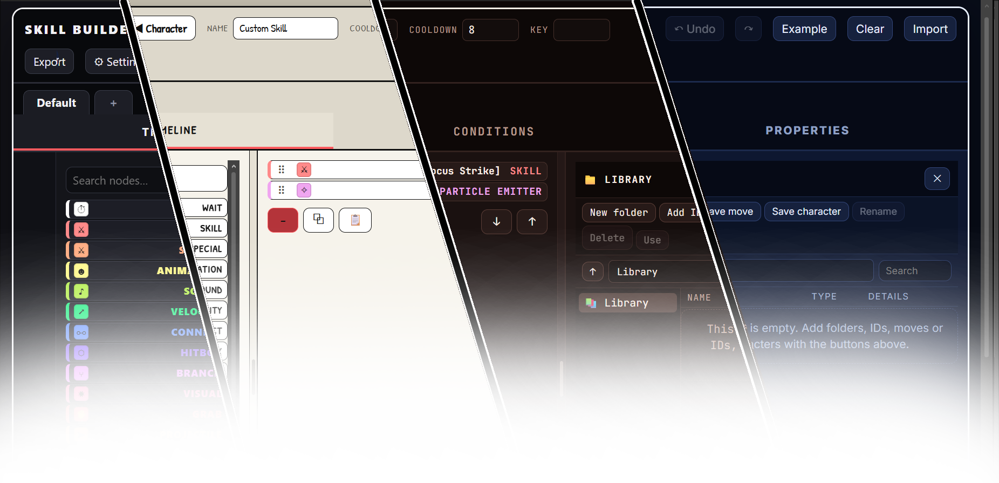

# Moonlight-Editor
This repo features an alternative and powerful skillbuilder for  JJS having numerous features and QOL inprovements.

# Where to find it
 * website: https://rafaggx2.github.io/Moonlight-Editor/
 * discord: -Temporarily Unavailable- 

# -FEATURES-
A list of the most important features includes:
  * Custom themes and fonts
  * Multi-Node edit
  * Re-orderable branches
  * Color picker for color fields
  * A save and load character menu
  * A library where you can save assets and moves
  * and many more to come.

# -NOTES-
The project is still in development as such some things are expected to change.
This project does use AI in its development, however its deeply tested by humans.
